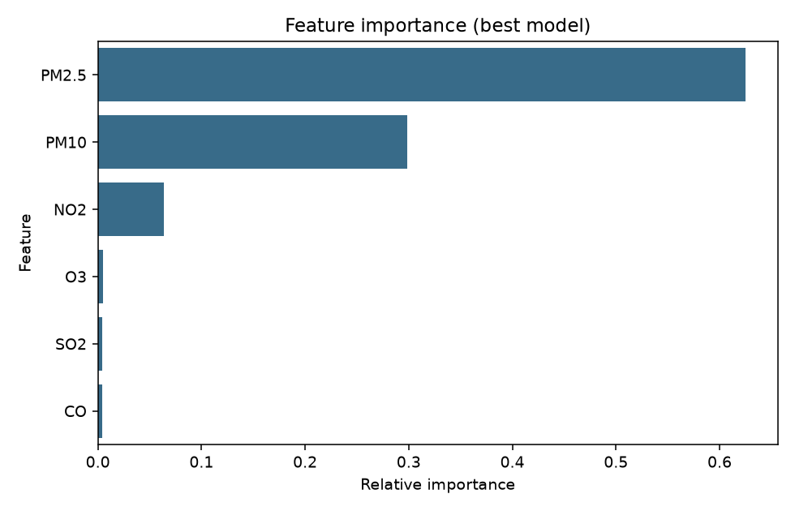
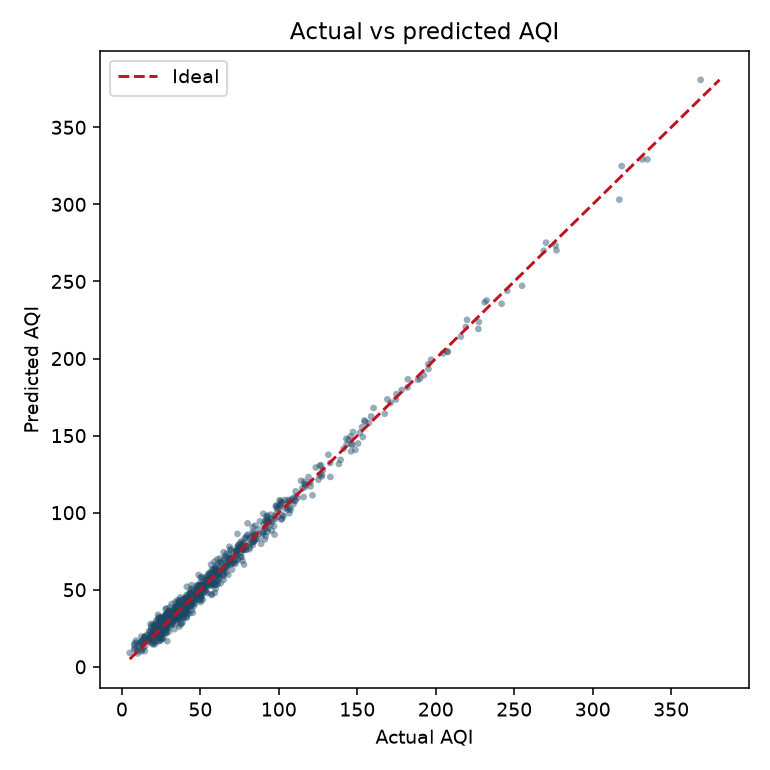

# Air Quality Prediction

[](https://huggingface.co/spaces/waleedarif1011/air-quality-prediction)
[](https://github.com/waleedarif1011/air-quality-prediction/actions/workflows/ci.yml)
[](LICENSE)

Predict **Air Quality Index (AQI)** from pollutant concentrations (CO, NO₂, SO₂, O₃, PM2.5, PM10), map the score to official **EPA health categories**, and explore a live Gradio calculator with city/event presets.

> **Live demo:** after the Hugging Face Space is created (see [Deploy](#deploy-hugging-face-space)), open the badge URL above. Until then, run locally with `python app.py`.

## Results (held-out 20%)

| Model | R² | MAE | RMSE |
|-------|----|-----|------|
| Linear Regression | 0.991 | 3.77 | 4.71 |
| Random Forest | 0.992 | 3.55 | 4.39 |
| **HistGradientBoosting** | **0.992** | **3.52** | **4.34** |

Best model by R²: `hist_gradient_boosting`. Full numbers: [`artifacts/metrics.json`](artifacts/metrics.json).

### Feature importance & actual vs predicted





## Quickstart

```bash
python -m pip install -r requirements.txt
python -m src.train          # train + write artifacts/ and assets/
python app.py                # Gradio demo at http://127.0.0.1:7860
```

### CLI inference

```bash
python -m src.predict --co 120 --no2 8 --so2 2 --o3 35 --pm25 6 --pm10 12
python -m src.predict --co 900 --no2 95 --so2 40 --o3 70 --pm25 180 --pm10 320
```

Returns JSON with `aqi`, EPA `category`, `color`, and `advisory`.

## Method (short)

- **Data:** Bundled `data/air_quality_sample.csv` (4k rows, six cities / pollutants + AQI). Optional full Kaggle pull via `scripts/fetch_data.py` when credentials exist.
- **Split:** 80/20 train/test (`random_state=42`).
- **Models:** Linear Regression (scaled), Random Forest, HistGradientBoosting — best saved to `artifacts/aqi_model.joblib`.
- **EPA mapping:** Good (0–50) → Hazardous (301+) with health advisory text in `src/predict.py`.
- **Demo presets:** Clean coastal day, Rush-hour smog, Wildfire smoke event.

## Tests & CI

```bash
python -m pytest -q
```

GitHub Actions runs the same suite on every push/PR (`.github/workflows/ci.yml`).

## Deploy (Hugging Face Space)

This repo is Space-ready (`app.py` + Gradio README frontmatter). Create and push:

```bash
# once: huggingface-cli login   # needs a write token with Spaces scope
huggingface-cli repo create air-quality-prediction --type space --space_sdk gradio -y
git remote add space https://huggingface.co/spaces/waleedarif1011/air-quality-prediction
git push space HEAD:main
```

Step-by-step: [`docs/hf-space-deploy.md`](docs/hf-space-deploy.md).

## Layout

```
app.py                 Gradio AQI calculator (3 presets)
src/train.py           multi-model train + metrics/plots
src/predict.py         CLI + EPA category mapping
data/air_quality_sample.csv
scripts/fetch_data.py  optional Kaggle download
artifacts/             model + metrics.json
assets/                feature importance + actual-vs-predicted
notebooks/             original exploratory notebook
tests/                 pytest suite
```

## License

MIT — see [`LICENSE`](LICENSE).
